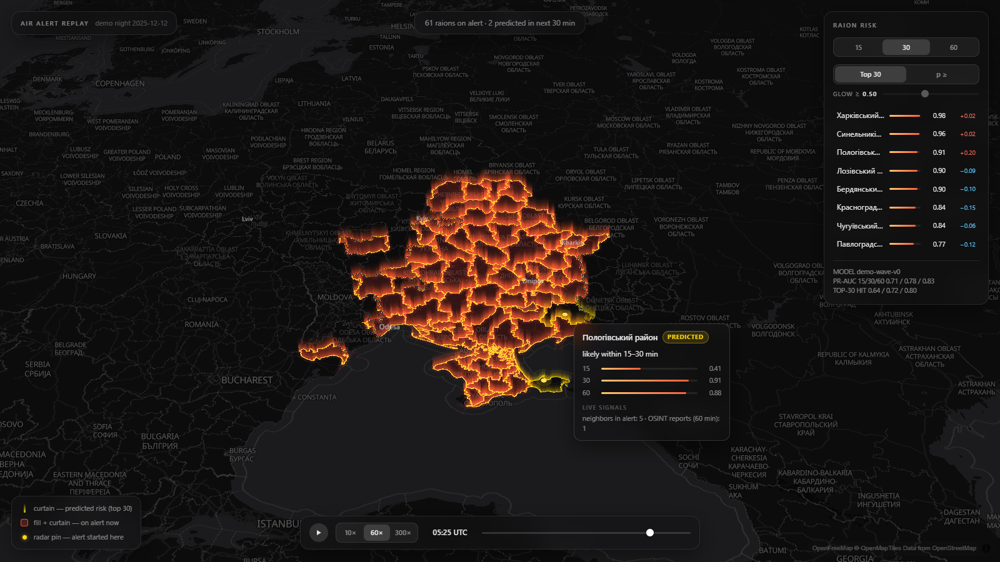

# Air Alert Analysis — Raion-Level Alert-Onset Prediction

Analytical research prototype (KSE Agentic AI School). Predicts which Ukrainian **raions** will transition to an air-raid alert state within the next **15 / 30 / 60 minutes**, and replays a historical mass-attack night on an interactive map with predictions shown against ground truth.

**This is not a warning system.** Alerts are a policy-driven proxy for threats, not a measurement; see *Limitations*.



## Quick start

Zero-setup demo: all replay artifacts are committed under [web/data/](web/data/), so a fresh clone can serve the map immediately — `python -m http.server 8765 --directory web`, then open any of:

- http://localhost:8765/?night=2025-12-12 — held-out demo night
- http://localhost:8765/?night=2026-06-20 — held-out validation night
- http://localhost:8765/?night=2026-10-08 — fully out-of-sample night

To reproduce the pipeline from scratch:

```bash
pip install -r requirements.txt

# 1. raw inputs (gitignored; download once into data/raw/ — scripts do NOT download them):
#    official_data_uk.csv   https://raw.githubusercontent.com/Vadimkin/ukrainian-air-raid-sirens-dataset/main/datasets/official_data_uk.csv
#    raions.geojson         https://neptun.in.ua/raions.geojson
#    alerts_2026-10-09.csv  external Telegram alert export for the Oct 8-9 night (not redistributable;
#                           skip -> everything except the 2026-10-08 night still works)

# 2. data foundation
python scripts/build_dataset.py
python scripts/import_external_alerts.py   # Oct-night intervals (needs alerts_2026-10-09.csv)

# 3. model chain — models/ is gitignored; train_model.py regenerates it (~20 s)
python scripts/build_features.py
python scripts/train_model.py
# re-score the held-out windows incl. the Oct night (train.parquet untouched):
python scripts/build_features.py --eval-only --intervals data/processed/alert_intervals.parquet data/processed/alert_intervals_oct.parquet
python scripts/evaluate.py
python scripts/export_predictions.py

# 4. map geometry for the frontend
cp data/raw/raions.geojson web/data/raions.geojson
cp data/processed/adjacency.json web/data/adjacency.json
python scripts/build_ribbons.py

# optional: signals sidecar (needs the Telegram pipeline below; replay works without it —
# signals_*.json are committed anyway)
python scripts/export_signals.py

# optional: Telegram threat-event features (Model B; no lift, not shipped)
python scripts/scrape_tme.py eRadarrua 2025-12-01T00:00:00 2026-09-07T23:59:59 data/telegram/eradarrua.jsonl
python scripts/scrape_tme.py kpszsu    2025-12-01T00:00:00 2026-09-07T23:59:59 data/telegram/kpszsu.jsonl
python scripts/parse_telegram.py data/telegram/eradarrua.jsonl data/processed/threat_events_eradarrua.jsonl
python scripts/parse_telegram.py data/telegram/kpszsu.jsonl    data/processed/threat_events_kpszsu.jsonl
python scripts/adapt_threat_events.py
# then rerun step 3 with --threat-events data/processed/threat_events.parquet
```

Note: `parse_telegram.py --llm auto` (default) needs **no extra packages** — the qwen-flash fallback is plain HTTPS via `requests`, enabled only when `DASHSCOPE_API_KEY` is set (e.g. in a gitignored `.env`); without it the parser runs regex-only and still produces the full event stream.

Offline demo insurance: [reports/demo_replay.mp4](reports/demo_replay.mp4) (72 s, Dec 12→13 2025 night incl. hover-card segment) and [reports/demo_replay_oct.mp4](reports/demo_replay_oct.mp4) (52 s, Oct 8→9 2026 night). Screenshots: [docs/screenshots/](docs/screenshots/).

## Approach

- **Target**: per-raion binary label — alert onset within horizon *h* ∈ {15, 30, 60} min — on a 5-min UTC grid. Official alerts are raion-level since late 2025; the modeling window is 2025-12-01 → 2026-09-07 (Vadimkin `official_data`).
- **Model**: one pooled global LightGBM classifier per horizon over 95 scored raions (23 near-permanent-alert frontline raions excluded). Features: own/neighbor-ring alert state and momentum (ADM2 adjacency graph), centroids, rolling intensity, diurnal/weekly cycles, national attack level. 5% negative downsampling; isotonic calibration with negatives re-weighted ×20.
- **Telegram block (Model B)**: 62,531 messages backfilled from @eRadarrua + @kpszsu public web previews (no account; `scripts/scrape_tme.py`), parsed by a hybrid regex+gazetteer parser (`scripts/parse_telegram.py`, optional qwen-flash fallback via DashScope) into 52,004 structured threat events → per-raion/5-min feature block.
- **Evaluation**: three held-out attack nights — 2025-12-12→13 (demo), 2026-06-20→21 (validation), and 2026-10-08→09 (fully out-of-sample, imported from an external alert export) — macro/micro PR-AUC + top-30 hit rate per 5-min step, against persistence and diurnal-climatology baselines.

## Results

Model A (history-only, shipped) vs baselines on the demo night — top-30 hit rate / micro PR-AUC:

| horizon | Model A | persistence | climatology |
|---|---|---|---|
| 15 min | **0.830** / 0.131 | 0.436 / 0.042 | 0.627 / 0.061 |
| 30 min | **0.805** / 0.200 | 0.417 / 0.096 | 0.601 / 0.129 |
| 60 min | **0.802** / 0.343 | 0.364 / 0.185 | 0.592 / 0.261 |

Validation night (2026-06-20) shows the same ordering (top-30: 0.861 / 0.777 / 0.657).

**Latest period — 2026-10-08→09** (fully out-of-sample; training data ends 2026-09-07; [eval report](reports/eval_2026-10-08.md)):

| horizon | Model A | persistence | climatology |
|---|---|---|---|
| 15 min | **0.870** / 0.165 | 0.420 / 0.042 | 0.502 / 0.047 |
| 30 min | **0.810** / 0.248 | 0.424 / 0.074 | 0.517 / 0.092 |
| 60 min | **0.673** / 0.340 | 0.447 / 0.148 | 0.492 / 0.175 |

(top-30 hit / micro PR-AUC). Caveat: the 2026-09-07 → 10-08 history gap means trailing intensity features under-read early in the night. Replay it at `?night=2026-10-08`.

**Ablation — Telegram features (Model B)**: no lift. Validation PR-AUC 0.747/0.825/0.889 vs 0.750/0.833/0.895 history-only; held-out nights comparable or slightly worse ([reports/metrics_telegram_ablation.json](reports/metrics_telegram_ablation.json)). National threat-event rate ranks top-10 by gain, but per-raion Telegram features (28% raion-resolved) add noise. Model A ships; the parsing pipeline remains for future work.

## Frontend

Static page ([web/](web/), no build step): MapLibre + OpenFreeMap dark basemap + deck.gl interleaved overlay over NEPTUN raion boundaries, at a cinematic 50° pitch. Active raions get a dark translucent red ground fill plus a **volumetric light curtain** rising from their border (single shader-injected layer, per-fragment vertical gradient); predicted top-30 raions get gold curtains (rank-based, matching the evaluation metric); radar-ripple pins mark ground-truth onsets. Hovering any raion opens a frosted-glass inspection card: state, time-to-onset band with 15/30/60 mini-bars, and live signals (neighbors in alert, OSINT reports). Replay dock with play/pause, 10×/60×/300× speeds, scrubber, keyboard controls; side panel ranks raions with per-step deltas. The render loop is memoized with quantized update triggers (p99 frame time ≤ 10 ms at 1440p@2× playing 300×). Data contract: [docs/prediction_contract.md](docs/prediction_contract.md) — the page is a dumb renderer; swapping the replay JSON for a live stream producer requires no page changes.

## Repo map

```
scripts/build_dataset.py           # intervals, raions.csv, adjacency.json
scripts/import_external_alerts.py  # Oct 2026 external CSV -> alert_intervals_oct.parquet
scripts/scrape_tme.py              # t.me/s backfill (bisect + resume)
scripts/parse_telegram.py          # regex+gazetteer -> threat events (optional qwen-flash fallback)
scripts/adapt_threat_events.py     # events JSONL -> parquet for feature builder
scripts/build_features.py          # grid expansion, labels, features (--eval-only, --intervals)
scripts/train_model.py             # LightGBM x3 horizons + isotonic calibration -> models/ (gitignored)
scripts/evaluate.py                # held-out nights vs baselines -> reports/metrics.json
scripts/export_predictions.py      # -> web/data/predictions_<night>.json
scripts/export_signals.py          # -> web/data/signals_<night>.json (OSINT counts sidecar)
scripts/build_ribbons.py           # web/data/raions.geojson -> ribbons.geojson (border rings)
scripts/gen_demo_predictions.py    # synthetic ?night=demo replay data
docs/model_spec.md                 # frozen training design
docs/prediction_contract.md        # pipeline <-> frontend interface
GLOSSARY.md                        # domain language
```

## Data attribution

The code is MIT ([LICENSE](LICENSE)); the data stays under its own terms:

- Alert intervals: [Vadimkin/ukrainian-air-raid-sirens-dataset](https://github.com/Vadimkin/ukrainian-air-raid-sirens-dataset) (`datasets/official_data_uk.csv`, MIT) — used per its license; not redistributed here (gitignored, re-download per Quick start).
- Raion boundaries: [neptun.in.ua](https://neptun.in.ua) `raions.geojson`, used under the published [API terms](https://neptun.in.ua/api-terms); `web/data/raions.geojson` is a verbatim copy, `ribbons.geojson` is derived from it.
- Telegram: public web previews (`t.me/s`, no account) of @eRadarrua and @kpszsu (Ukrainian Air Force Command) — parsed message text is not redistributed; only aggregate per-raion counts ship in `signals_*.json`.
- Basemap: [OpenFreeMap](https://openfreemap.org) tiles / CARTO dark style, map data © OpenStreetMap contributors (attribution rendered in the page).
- `data/raw/alerts_2026-10-09.csv` (Oct 8–9 night ground truth): third-party Telegram alert-tracker export, not redistributable — required only to reproduce the 2026-10-08 night; the exported replay JSON for it is committed.

## Limitations

- Alert onsets are a **delayed, policy-driven proxy** for threat presence — not per-drone tracks. All evaluation is against this proxy; cross-checks use Air Force morning summaries.
- Macro PR-AUC at long horizons is still beaten by diurnal climatology on quiet nights — honest signal that per-raion timing is dominated by routine.
- Telegram features showed no lift under this encoding; raion-resolution of free-text OSINT remains the bottleneck.
